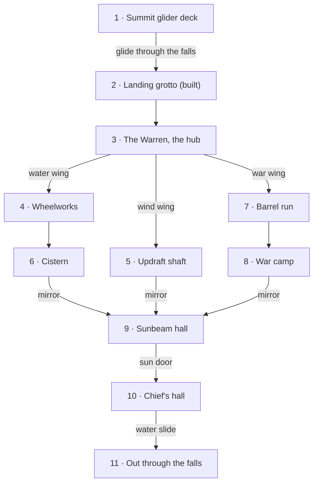
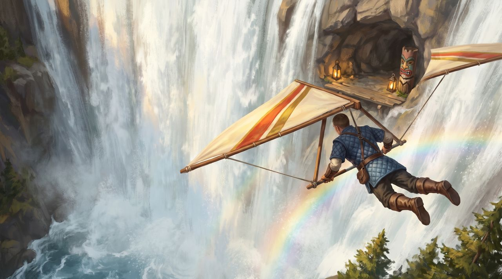
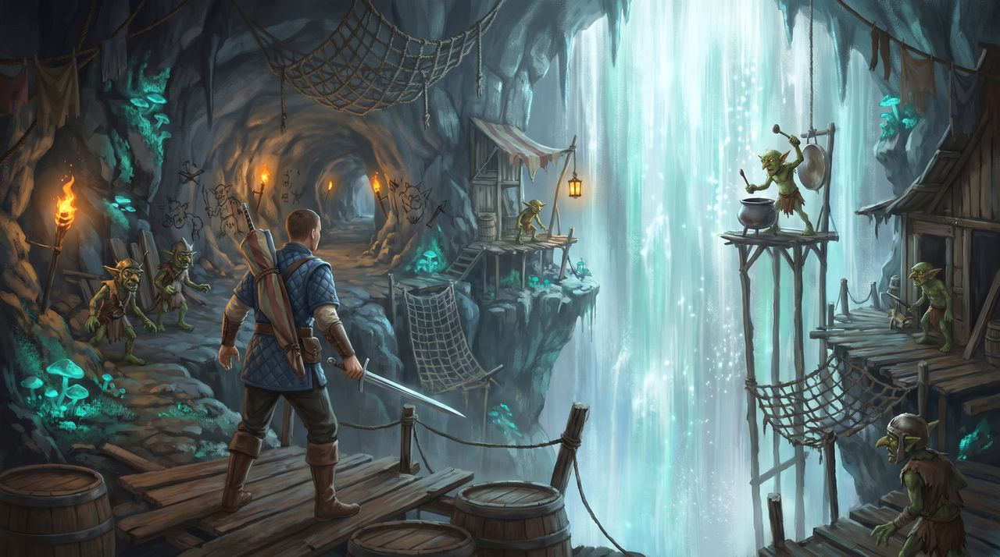
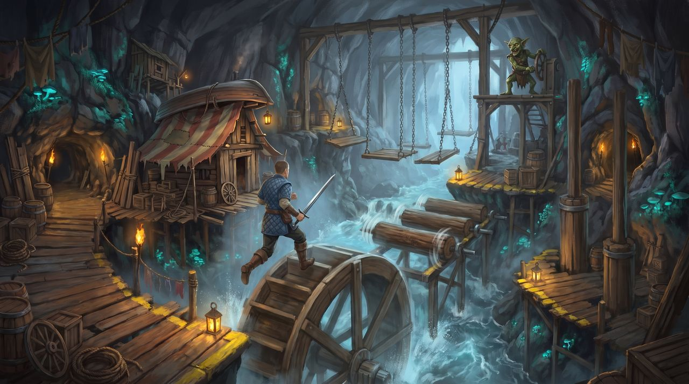
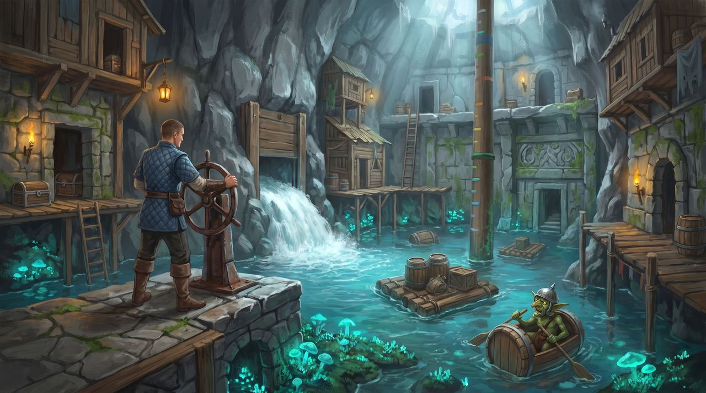
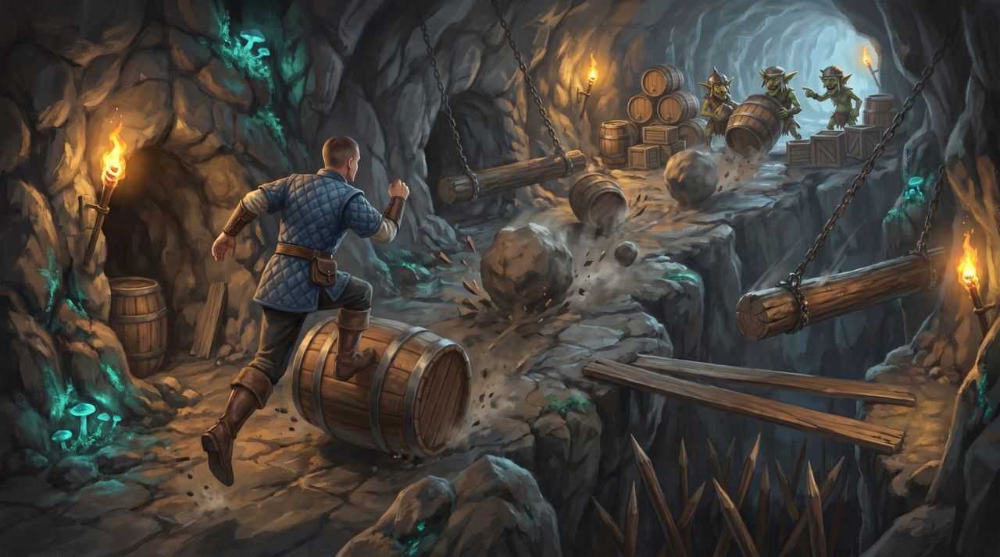
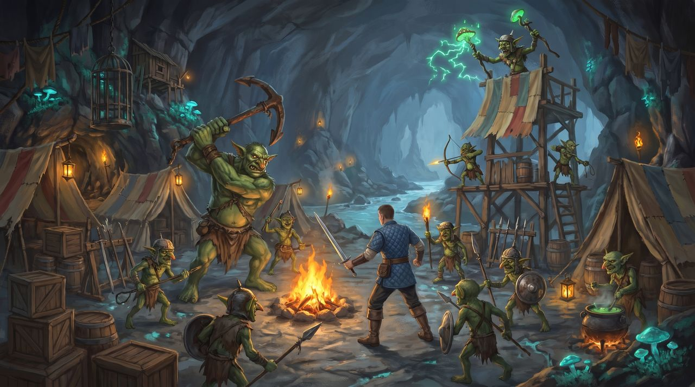
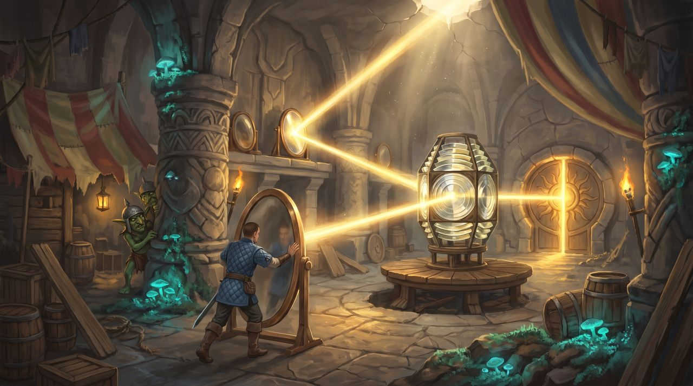
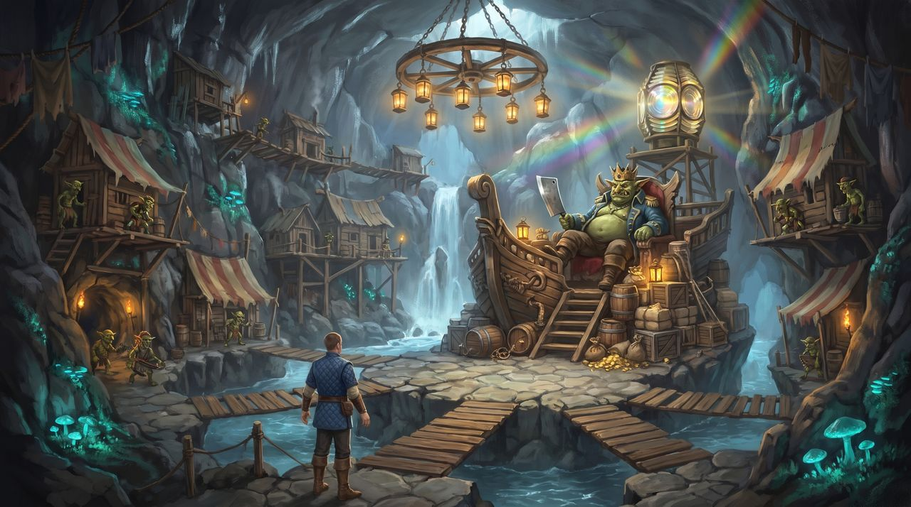

# Goblin's Dread: the level plan so far

This is what the concept art laid out (`concepts/`). The user kept every room, but nothing past the
inner grotto is built, and the plan below hasn't been approved room by room yet: it's the starting
point for that conversation, not a spec.

## The shape of it

A hub with spokes, like the castle in Super Mario 64. The Warren, the goblins' town, sits in the
middle of the mountain. Three wings branch off it at different heights: water, wind and war.
Clearing a wing sets one of the three mirrors in the Sunbeam Hall. With all three set, a sunbeam
bounced through the stolen lighthouse lens opens the sun door to the chief's hall at the heart of
the mountain. A water slide takes you out through the foot of the falls into the plunge pool, which
mirrors the way in.

The numbers match the cutaway painting.

## The rooms

### 1-2. The way in and the landing grotto (built)

 

- Flying through the water is the only way in.
- Painted: the back of the waterfall as a glowing wall, catch nets, a lookout perch with a pot gong,
  and a warning totem.
- Planned: reach the lookout before he bangs the gong and the Warren stays calm. If he bangs it, a
  wave of goblins comes down the tunnel. Goblin cave drawings along the tunnel hint at the rooms
  ahead.
- Built today: the open-world ledge with the portal, then inside the copy the inner grotto (stage,
  nets, lookout, totem, drawings) with the tunnel ending at a goblin barricade. There's no lookout
  goblin yet.

### 3. The Warren (the hub)

- A goblin shanty town clinging to a cavern about 100 m high. It's built from loot stolen off
  Emberholm's trade roads (sailcloth, cider casks, iron crates, an upturned rowboat), which explains
  where the island's lost cargo went.
- Three waterwheels on the underground river (the one that becomes the waterfall) drive the town's
  machinery.
- Tunnels at different heights lead to the three wings.
- Goblins go about their lives (cooking, hauling, napping) until the alarm sounds.

### 4. The Wheelworks (water wing, jump puzzle)

- Leap across a turning waterwheel's paddles, logs spinning on axles, planks swinging on chains and
  pistons rising and falling.
- A goblin on a gantry cranks the machinery faster; knock him off and it slows.
- Every safe landing has yellow-painted edges and a lantern.
- A fall drops you in the river, which washes you back to the start rather than killing you.

### 5. The Updraft Shaft (wind wing, glider puzzle)

- The wind that names the Windspire howls up a chimney inside it. Ride the updrafts on your glider,
  ledge to ledge, toward a ring of daylight.
- Streamers and windsocks show where the air rises. Windmill fans could switch the draft on and off,
  for timing.
- Goblins on patched kite-gliders try to net you out of the air.

### 6. The Cistern (water wing, water-level puzzle)

- Valve wheels raise and lower the water. Rafts and crates rise with it to reach doors and treasure
  at every height.
- A ship's mast painted with coloured notches is the gauge.
- This is the first of the older carved halls under the goblins' timber.

### 7. The Barrel Run (war wing, gauntlet)

- Goblins roll barrels and boulders down a steep ramp, past swinging log rams and a pit of stakes.
- Jump the barrels, duck into side alcoves, time the rams. At the top, the barrel crew is yours to
  fight.

### 8. The War Camp (war wing, fight)

- A goblin camp in a broad cavern: tents of stolen sailcloth, a bonfire, a hanging cage.
- A readable mix of enemies: spearmen with pot-lid shields who rush you, archers and slingers on a
  watchtower, a shaman with a glowing mushroom staff (a caster to interrupt), and a brute swinging a
  ship's anchor with a slow, telegraphed swing.
- These should be the goblin session's Split-Eye war-band, not the painted stand-ins.

### 9. The Sunbeam Hall (light puzzle)

- An old carved hall. One sunbeam comes in through a crack and is bounced by turning mirrors through
  the stolen lighthouse lens onto a round sun door.
- Each wing you clear sets one more mirror, so the door needs all three.

### 10. The Chief's Hall (boss)

- The goblin chief on a throne built from a wrecked ship's prow, in a stolen captain's coat and a
  crown hammered from a lantern's brass rim, with a huge cleaver. The lighthouse lens glows behind him
  on a scaffold.
- The arena is a ring of stone islands over water joined by plank bridges. The bridges break during
  the fight and the arena shrinks. Goblins in the galleries throw junk.
- The reward is the lens, which takes you on to the lighthouse quest.

### 11. The way out

- A rushing water slide from the chief's hall out through the foot of the falls into the plunge
  pool.
- The other idea: ride the wind shaft back up to the summit deck.

## What the game needs for this

| Need | For | Today |
|---|---|---|
| Goblins in a copy, spawned per copy and staying dead in it | Every fight | Split-Eye goblins exist on beta; copies have their own actors (`ChannelGame::copy`), but nothing spawns in them yet |
| Monsters that collide with walls | Any walled room | Monsters ignore colliders (`crates/engine/src/actors.rs`) |
| Moving platforms you stand on (waterwheels, swinging planks, pistons, rafts) | Wheelworks, Cistern | Vehicles are movers you bump into; nothing carries a player yet |
| Water above sea level that you wade and swim in | The river, the Cistern, the plunge pool | Rules water is sea level only (`Heightfield.water`); the pools are under 0.5 m in the rules |
| Updrafts inside a dungeon | Updraft Shaft | Updrafts come from the island's recipe (`emberholm.json`); a dungeon needs its own |
| Falls that send you back to a checkpoint | Jump puzzles | A copy puts anyone who falls out of it back at `arrive` (`catch_fallers`); needs per-room checkpoints |
| Switches, valves and mirrors that the party shares | Cistern, Sunbeam Hall, the alarm gong | No shared puzzle state in a copy yet |
| A level plan approved room by room | Everything | This file is the start of one |
