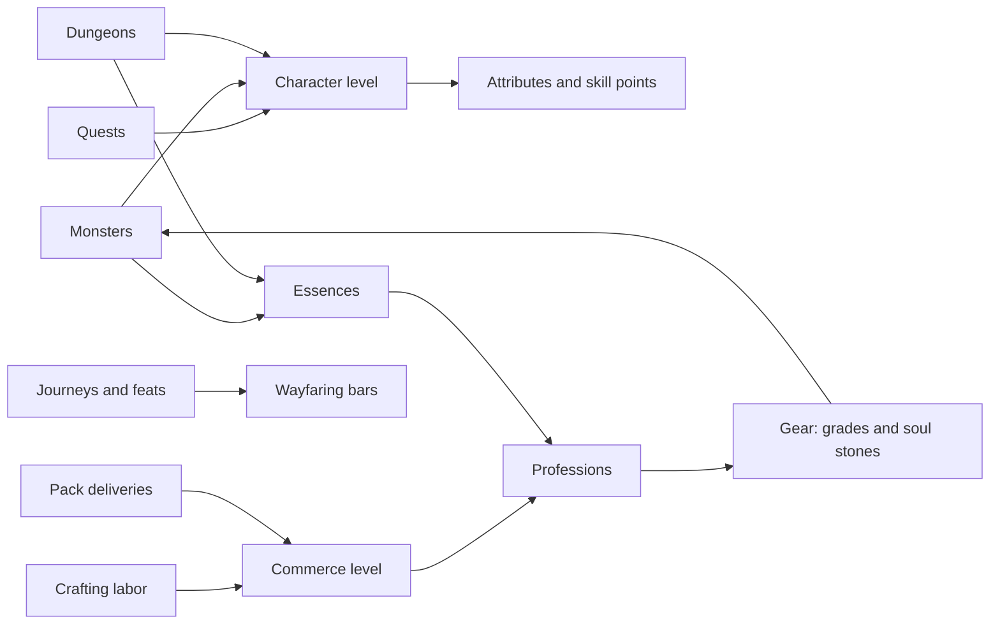

# Levels, Professions, Wayfaring and Gear

This plan covers four systems that give Ruina its progression: character levels with attributes and
skill points, a Commerce tree of professions, Wayfaring trees for getting around, and gear that is
upgraded and socketed with soul stones. It is a concept plan, worked out with the user on 2026-11-06
over two review rounds, and nothing is built. Every number is a first guess to tune in play, and like
the rest of the game's content, all of it would live in `shared/*.json`. What was decided, and by
whom, is listed at the end.

**TLDR.** Quests, monsters and dungeons raise your **character level**, and each level gives 10
attribute points and 1 skill point. Crafting and pack runs raise your **Commerce level**, which you
spend across seven professions: enough to master two. Moving raises five separate **Wayfaring** bars
(foot, saddle, wheel, keel and wing), and you can max all of them. **Gear** links everything.
Monsters drop essences, Soulbinders turn them into soul stones, and smiths make and upgrade the
weapons and armor. Anyone can roll for grades and stone levels, and the odds are always on screen.

## How It Fits Together

| Today | Becomes |
|---|---|
| No character levels: 2 starting skill points, plus 29 from Emberholm's quests and milestones | A character level from XP: 10 attribute points and 1 skill point a level |
| The tree hands you your weapon (Sword Training gives the sword) | The tree teaches the weapon; the item in your hand does the hitting |
| 100 HP, 100 stamina, 100 MP for everyone, no armor | Attributes, armor and soul stones change them |
| Weapons, abilities and movement skills level by use (10 levels, +3 to 5% each) | Kept, as mastery of each weapon and skill |
| Proficiencies planned (labor spent levels a trade) | The Commerce tree |
| Mounts, vehicles, ships and gliders have no progression | Five Wayfaring trees |

The loop that matters: fighters need crafters (stones, oils, meals, scrolls) and crafters need
fighters (essences from monsters and dungeons). Neither side can skip the other.

## Character Level

- **XP sources.** Quests give most of it early on. Monsters give more for packs and elites, and next
  to nothing when they're far below your level. Dungeons give XP for each boss, plus a bonus for the
  clear. A party shares kill XP, with a bonus for grouping.
- **Pace.** Emberholm will be reworked before launch, and a first run through it should end at
  **level 10**. The cap is **60**, for the zones that come after it.
- **What a level gives.** 10 attribute points, 1 skill point and a little base HP.
- Life quests (farming, gliding, packs, ships) give character XP too, plus Commerce or Wayfaring XP.
- Existing characters get XP for the quests they've already finished, worked out the same way their
  skill points are today.

## Attributes

You place 50 when you make a character and 10 more each level: 140 by the time you leave Emberholm
at level 10, and 640 at the cap of 60.

| Attribute | Raises | Suits |
|---|---|---|
| **Strength** | melee damage, max HP, how much your guard holds | club, sword |
| **Dexterity** | bow damage, wind-up speed, stamina and its refill | bow, sword |
| **Intelligence** | spell damage, healing, MP and its refill, cast speed | staff |
| **Luck** | critical hits, essence drops, better loot | anything |

- **Small steps.** A point adds about 0.2% to what it raises, so a build takes shape over many
  levels, not in any single one.
- **Thresholds you can feel** at 100, 200 and 300 points in one attribute. At 200, for example:
  Strength shrugs off one knock-down every 30 s. Dexterity refunds a dodge's stamina when the dodge
  slips a hit at the last moment. Intelligence keeps small hits from breaking a cast. Luck puts a
  quarter of the Fortune meter back after every critical hit.
- **A Fortune meter, not dice.** Every hit fills the meter by an amount based on your Luck, and when
  it's full your next hit is critical. You see it coming and can save it for the hit that matters.
  Because there's no random roll, the browser and the server always agree on which hits crit.
- **Gear needs attributes**, as in Path of Exile 2. A Mythic bow might need 150 Dexterity, so
  attributes are part of the gear chase.

## Skill Points

- **1 per level**, spent in the combat tree as it is today, plus **bonus points** from big quests
  and dungeon firsts. Emberholm would give about 10 of these, from quests like A Place to Call Home,
  A Ship of Your Own and the first clear of Goblin's Dread. Small quests give XP only.
- You'd leave Emberholm with about 21 points (2 to start, 9 from levels, about 10 in bonuses), down
  from today's 31. The tree's costs need a look for a starter island: today a keystone is 8 to 13
  points from nothing. At the cap it's about 85 points with later zones' bonuses, still well under
  half the tree, so every build has to choose.
- The training yard and the battlefield keep their flat 30 points, which you can change freely as
  you can today.
- **Respec only by scroll.** A Runescribe's scroll is the only way to take points back: Unlearning
  for skill points, Reshaping for attributes. A lesser scroll returns 5 points, and a greater one
  resets everything. Planning stays free, since the tree already lets you plan a path before you
  press Learn, but today's free right-click refund goes away.

## The Commerce Tree

You have one **Commerce level** (1 to 50, a point each level), earned by:

- **Crafting**: XP for the labor a recipe spends, with more for higher tiers. Labor already limits
  how much you can craft, so spamming cheap recipes is no shortcut.
- **Pack runs**: XP on delivery, scaled the same way as the pay (longer and riskier routes pay
  more), with a bonus for contracts.

The tree works like the combat tree. It has seven branches, and each takes **25 points to master**,
so 50 points master two professions or take four halfway. Each branch opens recipe tiers at 5, 10,
15, 20 and 25 points, has passives along the way (less labor, faster crafts, better quality, a
chance of double output) and ends in a **masterwork**. Gathering (farming, herding, logging, mining)
stays open to everyone.

| Was | Name | Makes | Masterwork |
|---|---|---|---|
| Weapon crafting | **Forgewright** | swords, clubs, staves, bows; tempering oil that upgrades weapons | **Maker's Mark**: your weapons carry your name and sometimes come out a grade higher; Mythic ones go up on a Hall of Arms in Lanternwick |
| Armor crafting | **Wardsmith** | plate, leather and cloth armor; rivets and thread that upgrade armor | **Tailored**: armor made for a named player is stronger but only fits them, so people commission you |
| Mechanist | **Cogwright** | automata for your land (a Rainhand that waters your plots, a Trough-tender that feeds your animals), parts for carts, ships and gliders | **Clockwork Heart**: your automata keep working while you're offline; later, the first airships |
| Cook | **Hearthkeeper** | meals, one long buff at a time (an hour), for combat or for life skills (labor refill, glide time, sail speed) | **Hearthfire**: a feast table that gives your whole party a second buff |
| Entrepreneur | **Chartermaster** | new and better packs; pack-running perks (packs stay fresh longer, slow you down less, and you can see every trading post's demand from anywhere) | **Charter Board**: post your own contracts, so other players run packs for you |
| Alchemy | **Soulbinder** | potions; soul stones distilled from monster essences; binding salt that helps a stone take | **Soul Anvil**: your anvil lends your socketing bonus to anyone you let use it, for a fee you set |
| Scribe | **Runescribe** | scrolls: Waystone (teleport, never with a pack on your back), Second Dawn (revive), Unlearning and Reshaping (skill and attribute resets: a lesser scroll returns 5 points, a greater one resets everything), Warding (the next upgrade or feed can't go backwards) | **Grand Scrolls**: the same scrolls, for a whole party |

Other names that fit: Warwright or Armsmith; Mailwright or Hidewright; Artificer or Tinker;
Feastwright or Provisioner; Caravaneer or Factor; Essencer or Crucible Adept; Glyphwright or
Inkwarden. Chartermaster takes its name from the Charter Seals that trade routes pay.

Runescribe is the hardest profession because it depends on all the others: ink from Soulbinders'
essences, vellum from livestock, rare reagents from dungeons. It's hard because of what it needs
from other players, not because of grinding. Its scrolls are also the only way to undo skill or
attribute points, so a Runescribe never runs short of buyers.

## Wayfaring (the Movement Tree)

The code already uses "movement skills" for dodge roll, backstep, block and slide, so the new tree
needs its own name. **Wayfaring** fits, since the island already has a Wayfarer glider and a
Wayfarer milestone. There are five trees, each with **its own XP bar, 20 levels and 20 nodes**, and
you can max all of them.

| Tree | Covers | XP from | Unlocks, for example |
|---|---|---|---|
| **Stride** | on foot | journeys on foot, climbs, long slides | a sprint, a longer slide, a wall jump, softer landings, faster swimming, a steadier stride under a pack |
| **Saddle** | donkey, horse | rides | a mount's sprint, calling your mount from anywhere, a mounted jump, pack animals keeping more speed |
| **Wheel** | cart, roadster, hauler | drives, deliveries by vehicle | a boost, better handling, repairs on the road, a convoy bonus |
| **Keel** | rowboat, sloop, cog | voyages, docking cleanly, rough weather | faster tacking, trimming sail, riding out storms, longer rowing; rams and cannons once piracy is in |
| **Wing** | gliders, later airships | glides, landing on a mark, thermals | longer glides, a dive and pull-up, thermals that lift you, an air brake |

- **Journeys and feats, not distance counters.** Most XP is paid when you arrive, based on how far
  you ended up from where you started (more with a pack aboard). Only travel you control yourself
  counts fully; auto-run and road travel earn little. The rest comes from named **feats**, tracked
  like today's milestones: glide from the Windspire to Lanternwick in one go, land on the ledge
  behind the falls, sail out in a gale.
- **Crossroads nodes** need two trees, such as Saddle 10 and Wing 10: leap from a galloping horse
  straight into a glide.

## Gear Grades

- **Slots**: a weapon and five armor pieces (head, chest, hands, legs, feet).
- **Bases**: a few per kind of weapon and armor (a short sword, a long sword), each with its own
  speed, damage or defense, and attribute requirements. **Bases never go out of date**: any base can
  climb from Crude to Ruinforged, so a piece and the stones in it can last a whole career.
- **Upgrading** is a roll at an anvil. It uses a Forgewright's tempering oil or a Wardsmith's rivets
  and thread (higher tiers raise the chance), plus coin and labor. The top grades also cost Charter
  Seals, which is what the design bible already says the best gear costs. Each grade raises the base
  attack or defense, and some grades open a soul slot.

| Grade | Color | Soul slots | Base | Chance to the next | A failure |
|---|---|---|---|---|---|
| Crude | grey | 1 | ×1.00 | 90% | costs the materials |
| Tempered | white | 1 | ×1.10 | 75% | costs the materials |
| Fine | green | 2 | ×1.22 | 60% | costs the materials |
| Proven | blue | 2 | ×1.36 | 45% | may drop a grade |
| Storied | purple | 3 | ×1.52 | 30% | may drop a grade |
| Fabled | orange | 3 | ×1.70 | 20% | may drop a grade |
| Mythic | red | 4 | ×1.90 | 10% | may crack: unusable until a smith repairs it, stones stay in |
| Ruinforged | gold | 5 | ×2.15 | | the top |

The names climb from craft (Crude, Tempered, Fine) through fame (Proven, Storied, Fabled, Mythic) to
Ruinforged.

- **Scars** soften bad luck. Every failed upgrade leaves a notch on the piece, and each notch adds 2
  points to its next try. A success uses up the bonus, but the notches stay, so a weapon's scars
  tell its story.
- **Looks**: the grade shows on the model (the made weapons glow brighter, and Ruinforged pieces
  have ember veins). From Fabled on, the owner can name a piece, and its tooltip shows the maker's
  mark and a kill count.
- Gear trades freely with its stones in it, and so do loose stones, so crafters have customers. The
  exception is Tailored armor, which binds to the player it was made for.

## Soul Stones

- **Thousands of stones from data, not code.** A stone is an **essence** (what it does) cut to a
  **quality** (how high it can go). Every creature drops its own essences, so each new creature adds
  a family of stones. Fifty creatures with a few essences each, cut two ways at five qualities,
  already gives well over a thousand.
- **Three kinds**, matching the tree's node types:

| Kind | Does | Example |
|---|---|---|
| **Lesser** (most) | changes a number the rules already use | Ember Shard: +6% fire damage |
| **Greater** | changes how a weapon or skill works, like the tree's Cleave or Whirlwind | Split-Eye's Glare: arrows fork in two |
| **Keystone** (rare) | a big effect with a cost | Pyre Coal: Meteor hits 40% harder, healing is 25% weaker |

- **Two cuts**: an essence cut as an **Edge** goes in weapons, and as a **Ward** in armor. A goblin
  essence, for example, gives more damage against packs on a weapon and less knock-back on armor.
- **Qualities**: Chipped, Flawed, Clear, Flawless, Radiant. **Levels** once socketed: I to X.

**Socketing** happens at a Soul Anvil, either in town or at a Soulbinder's own anvil for their bonus.
A stone that fails to take crumbles to soul dust, and the piece is never damaged.

| Quality | Takes | Lands at |
|---|---|---|
| Chipped | 60% | I–II |
| Flawed | 70% | I–III |
| Clear | 80% | II–IV |
| Flawless | 90% | III–V |
| Radiant | 95% | IV–VI |

**Feeding** means using a stone of the same essence to try to raise a socketed one.

| Level now | Rises | Nothing | Drops a level | Shatters |
|---|---|---|---|---|
| I–III | 85% | 15% | | |
| IV–VI | 60% | 25% | 15% | |
| VII–VIII | 35% | 35% | 25% | 5% |
| IX | 15% | 40% | 35% | 10% |

These odds are for a Clear feeder. Each quality step above Clear moves 8 percentage points from the
bad outcomes to Rises, and each step below does the opposite. A Radiant feeder can **surge**,
raising the stone two levels at once. A shattered stone empties its slot but leaves dust for making
new stones, so a failure is never a total loss.

- **Resonance**: three stones of one family across your gear (three Ember stones, say) unlock a
  bonus, and five unlock a stronger one. That gives set bonuses without needing new stones.
- **Stones stay put.** Once socketed, a stone stays in that piece for good and never moves to
  another one. Socketing a different essence into its slot replaces it, breaking the old stone, but
  only if the new one takes.

## Fair Play

- **Nothing that changes the odds is sold for money**: no protection, pity, stones or scrolls. They
  come only from play and from crafters (the design bible's "pacing, never paywalls").
- **The odds are on screen** before every roll, including the effect of scars and the feeder's
  quality.
- **The server rolls** every upgrade, socket and feed with the game's seeded RNG. The browser plays
  the anvil strike and shows the result.
- **The battlefield stays level**: it gives everyone the same gear, just as it gives everyone 30
  skill points. Open-world fights use what you've made.

## Building It

Each step is playable on its own. Its rules go into TypeScript and Rust together, with conformance
tests to keep them in step.

1. **Levels and attributes**: XP and levels, attribute and skill points from levels, the new stats
   (max HP, armor, critical hits), and XP for quests already finished.
2. **Gear and grades**: weapons as items (the tree still teaches them), armor slots, bases, and the
   upgrade roll with scars.
3. **Soul stones**: essences from slimes and goblins, socketing and feeding, and the first 30 or so
   stones.
4. **Commerce**: the tree, then the professions that feed gear first (Forgewright, Wardsmith,
   Soulbinder), then Hearthkeeper, Chartermaster, Cogwright and Runescribe.
5. **Wayfaring**: the five bars, the feats and the trees.

Attributes, grades, stones and meals all work as modifiers through the system the skill tree
already uses (`stat`, `op` and conditions in `src/skills.ts` and `server/src/skills.rs`), so most new
content is a line of JSON.

## Decisions

Decided by the user in review:

| Decision | Section |
|---|---|
| Emberholm (to be reworked before launch) ends at level 10; the cap is 60 | Character Level |
| Big quests and dungeon firsts still give bonus skill points; small quests give XP only | Skill Points |
| Only a Runescribe's scroll takes skill or attribute points back | Skill Points |
| Luck crits through a Fortune meter and has no effect on crafting odds | Attributes |
| The names: Forgewright, Wardsmith, Cogwright, Hearthkeeper, Chartermaster, Soulbinder, Runescribe; Wayfaring with Stride, Saddle, Wheel, Keel and Wing; the grades Crude to Ruinforged | The Commerce Tree |
| Gear can crack but is never destroyed | Gear Grades |
| Soul stones stay in their piece and never move to another | Soul Stones |

Approved as written in the first round: Attributes, The Commerce Tree, Wayfaring, Gear Grades, Soul
Stones and Fair Play.

Proposed in the second round and not yet answered, so they stand as written until the user says
otherwise:

| Proposal | Section |
|---|---|
| Runescribes make a lesser reset scroll (5 points back) at an early tier, and a greater one that resets everything | Skill Points |
| Socketing a different essence over a stone breaks the old one, but only if the new one takes | Soul Stones |
| Bases have no tiers: any base can climb from Crude to Ruinforged | Gear Grades |
