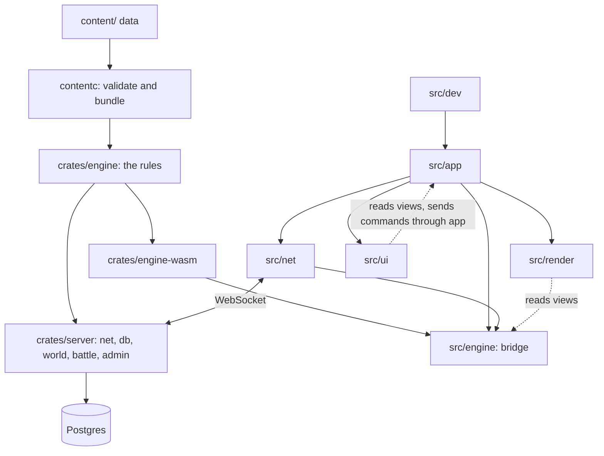
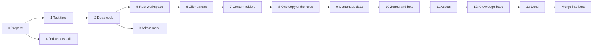

# Ruina's First Refactor

Status: **approved with changes, in progress** (reviewed 2026-11-05). Work happens on branch
`refactor/first` in the worktree `C:\GitHub\games\yggdrasil-refactor`, branched from `beta` at
d49c3b8. Every task is in [tracker.md](tracker.md); what has landed so far, with numbers, is in
[progress.md](progress.md); what the survey found is in [inventory/](inventory/). A session picking
this up reads this page, then the tracker, then the progress report, then the inventory file for the
phase it works on. All phases run to the end without waiting for review; the report is written as
they go.

## Why Now

Ruina grew from nothing to an online open world in four days, built by many sessions at once. It
works, and every feature branch is merged into `beta`, so this is a quiet moment to look after the
code before it grows further. What hurts today:

- **The rules are written twice.** About 10,000 lines of TypeScript in `src/sim/` and their Rust
  twins in `server/src/` must agree, held together by conformance tests that drive six Rust check
  programs (and they agree only to about a millionth: the maths functions differ in the last bit).
  Every rule change is made twice.
- **A few files do everything.** `src/main.ts` (2,451 lines), `src/ui/life/lifeUI.ts` (2,050),
  `src/library/app.ts` (1,912), `server/src/life/vehicles.rs` (1,809).
- **Content is half data.** Spawns, NPC dialogue and looks, dungeon art, mini-game boards, weapons
  and every model are code; lists must stay in the same order in TypeScript, Rust and saved builds;
  nothing checks the JSON (a misspelt field silently becomes zero).
- **Every test goes through a browser.** 395 tests, ~12 minutes here and up to an hour a shard in CI,
  although 104 of them never open a page and about 150 more need no drawing. And CI, which draws in
  software, gets the old toon look and the box hero, so it tests different code from what players see.
- **The Rust crate is one block.** Touching one rules file costs 51 s to rebuild its tests (106 s in
  release, as CI and the tests run them); the tests themselves run in 2 s.
- **The developer pages exist only under `npm run dev`.** None of them are built for beta, and
  there is no notion of an admin.
- **The docs drift.** AGENTS.md is one dense table; the design bible is current today, but only
  because each session remembers to update it.

## Goals

These are the asks, written as outcomes we can check.

1. **One copy of the rules.** A Rust engine crate holds every rule. The server runs it natively,
   the browser as WebAssembly. The TypeScript rules and the conformance tests are deleted.
2. **Areas that can be worked on alone.** Engine; server (network, database, world); client (app,
   network, rendering, UI, input, developer pages); content; tools; tests; docs. Each has a folder,
   a short AGENTS.md, a way to test it by itself, and import boundaries a test enforces.
3. **Content as data, in folders.** One creature, NPC, area, skill, item or vehicle can span several
   small files. Adding one of a kind the engine already knows needs no code. Content is validated,
   and saves and the network refer to things by id, never by position in a list.
4. **Fast checks.** Unit tests (no browser) in about a minute; a Rust edit tested in under 25 s;
   integration tests before a push to `beta`; stress tests only before a release.
5. **No dead code**, and checks that keep it out.
6. **An admin menu** that reaches every developer page (the yard, the animation library, the PvP
   battlefield, ...), shown to admins only, on beta as well as locally.
7. **A game that can grow well past 64 MB.** Big files live somewhere that scales, every asset is
   listed with the zones that use it, and the game loads what the world near you needs. The client
   will be packaged as a desktop app later (D15), so keeping a browser's download small is not a goal.
8. **A `/find-assets` skill** for finding and fetching models, animations, textures, sounds, music,
   effects and fonts.
9. **AGENTS.md rewritten**, with checks that catch stale paths.
10. **The design bible as a knowledge base** anyone can read: every system and every piece of content,
    exactly, with numbers from the game's own data, and a test that keeps it complete.
11. **The yard and the battlefield as developer zones**, reached from the admin menu, with bots as a
    core engine feature any zone can spawn and no server code that exists only for testing.

## Where We Start

Measured on this machine on 2026-11-05; the details are in
[inventory/baseline.md](inventory/baseline.md).

| | Today |
|---|---|
| TypeScript client | ~55,000 lines; rules ~10,100 of them |
| Rust server | ~24,250 lines in one crate, 8 binaries |
| Tests | 395 Playwright (104 never open a page), 182 Rust |
| Whole Playwright suite | ~12 min here, 10 to 60 min a shard in CI |
| Rust: edit a rules file, test it | 51 s debug, 106 s release (running them: 2 s) |
| Rust: edit a rules file, release build | 1 min 38 s |
| Typecheck / Vite build | ~12 s / ~3 s |
| Built game | 15 MB, all in the first download, no cache headers |
| Repository | public, 31.8 MB tracked; the baked island (3.5 MB) is rebaked into history at every island change |

## Where We're Going

The repository after the refactor:

```text
crates/                 Rust workspace (Cargo.toml at the root)
  engine/               the rules, one copy: movement, traversal, combat, skills, creatures and
                        their AI, life systems, mini-game rules, the world map and its regions'
                        generator, content types and loading. Deterministic. Built natively and
                        for WebAssembly
  engine-wasm/          the browser's way into the engine, thin
  world-api/            the messages between the server's tiers, ids and ticks (no I/O)
  server/               the game server in tiers, one process until the multi-server plan:
                        gate/ (connections, sign-in, interest, encoding), sim/ (regions'
                        channels, instances' copies, borders), store/ (accounts, characters,
                        land, plots, the ledger, migrations), social/ (parties; later friends
                        and guilds), directory/ (which simulation runs what), admin/
  tools/                balance, loadtest, contentc (content compiler)
content/                every piece of game data (today's shared/), a folder per kind and a
                        file or folder per thing; JSON Schemas generated from the engine's types
src/                    the browser client (TypeScript)
  app/                  start-up, modes (title, world, yard, battlefield), the loop, URL options, test API
  engine/               the bridge to the engine (WebAssembly) and the types it generates
  net/                  the world connection, prediction, other players, monster timelines
  render/               three.js: the world, bodies, models, creatures, effects, the look
  ui/                   components (windows, tabs, slots, menus) and the windows built on them
  input/                keyboard, mouse, controller
  assets/               the asset manifest and loader (streaming, caching)
  dev/                  the admin menu and every developer page
tests/
  unit/                 Vitest in Node, no browser: TypeScript logic
  integration/          Playwright: the game in a browser, with servers
  stress/               frame rates, 10,000 fighters, load tests, many windows
  support/              helpers
tools/                  asset finding and fetching, icons, images, models, bug reports
design/                 the design bible and its tracker, design/status.json
docs/                   guides for people and agents: architecture, engine, content, testing, assets, deploys
.plans/                 plans in flight (dungeons, this refactor)
```

How the areas depend on each other (an arrow means "uses"):



### One World

Decided on 2026-11-06 (D16-D19), after the research in
[`.plans/world/research.md`](../world/research.md).

The main world is one seamless open world made of regions defined by data. Emberholm is the first
region. Regions meet across sea or land, and crossing a border loads nothing. Dungeons and the
developer zones are instances, played in copies.

The aim is up to 100,000 players on one world. No single process can carry that, so the world is
split twice:
- **By area.** Each region is owned by one simulation. Neighbours keep read-only ghosts of what
  stands near their shared border, and hand authority over as things cross. A gateway keeps each
  player's connection while the simulation behind it changes. Regions are placed on servers
  automatically.
- **By crowd.** A region past its soft cap opens another channel (a copy of itself), placing players
  by party, friends and guild, and closes it again when quiet. The land is the same in every
  channel: houses, farms, and plots that are scarce and contested, as in ArcheAge.

This refactor lays the foundations in one process (Phase 10): every boundary a multi-server world
needs, crossed by in-process calls. The multi-server version comes after the merge, and with it
large-scale PvP and hosting at scale; it then changes transports, not designs. Splitting a region's
own area under load comes last, and only if sieges or world bosses need it. The 256 m chunk is the
unit of authority, so that split can come without a rewrite.

## How We Work

- **Branches.** Every phase is done on `refactor/first` before anything merges into `beta`. `beta` is
  merged into the branch at the end of each phase, so the branch never falls far behind. When the
  last phase is done and every tier is green (unit, integration and stress), the branch merges into
  `beta` once, is pushed, and I check the deploy.
- **The progress report.** [progress.md](progress.md) gets an entry as each phase lands: what
  changed, the numbers against the baseline, decisions made on the way, problems, and what's next.
  Work doesn't stop to wait for it to be read.
- **Moves apart from changes.** A commit that moves files changes nothing else, so git follows
  the history and a review is easy. Every move goes into `moves.tsv` (old path, new path); a script
  uses it to fix imports, docs, `design/status.json` and the skills, and can bring any other branch
  across the same moves.
- **One rule set at a time.** The rules move to the shared engine one subsystem at a time. Each
  runs beside the TypeScript copy and is compared step by step before the TypeScript copy goes.
- **The tracker is the record.** Every task is in [tracker.md](tracker.md) with what "done" means.
  It is ticked when done and verified, and each landing is logged with its commit.
- **Docs move with the code.** A phase isn't done until AGENTS.md, the design bible
  (`design/status.json`) and the tracker say what changed.
- **Other sessions.** Phases 5 to 8 move most files. Feature work elsewhere during them either
  waits or rebases with the moves script.
- **The game barely changes for players.** They see the admin menu (if they're an admin), the new
  look on machines that drew the toon look, and the knowledge base. `tests/look.spec.ts` shoots the
  same places before and after the client phases.

The order, and what can run alongside:



## Phase 0: Prepare and Measure

Size: small. Nothing in the game changes.

- The branch, the worktree and the survey (done; see [inventory/](inventory/)).
- A timing reporter for Playwright, so every later phase can show what it saved per test.
- A baseline: the whole suite on this branch with a private server, recording each test's time and
  any test that fails before we touch anything.
- A short checklist for you to play the five recent pushes on beta (Lanternwick's buildings,
  Goblin's Dread's way in and parties, the goblins in the yard, the painted icons, the animation
  library), so a bug found later isn't blamed on the refactor.
- Tidy branches and worktrees (agreed): delete the merged branches and worktrees, the stale
  `origin/main`, and the locked agent worktree once its 23 uncommitted changes are confirmed to be in
  `beta`.
- **Git LFS** (decided): models, textures, icons, icon sheets, fonts, concept art and other binaries
  move to Git LFS, without rewriting history (old copies stay in history; nothing is force-pushed).
  CI checks out LFS files, and the Docker build gets them.
- The refactor goes into the design bible as a feature in progress, and
  [progress.md](progress.md) starts.

Done when the baseline is recorded, the tree is tidy and new binaries go to LFS.

## Phase 1: Test Tiers

Size: medium. Do this first: every later phase is checked faster for it.

- **Unit** (`npm run test:unit`): Vitest 4.1 in Node, plus `cargo test` for Rust. Fast, no browser,
  no server. It takes first the tests that never open a page (skill tree, progress, input, roads,
  village plans and more), then about 82 more once a headless harness can run the yard and the
  island without drawing (movement, goblins, slime packs, hotbar, 20 of the open-world tests), then
  about 64 gallery tests once the model and rig builders stop making a WebGL renderer when imported.
- **Integration** (`npm run test:integration`): Playwright, the game in a browser with its servers:
  the HUD, windows, input, online play, parties, mini-games, updates, pixel checks. Run before
  every push to `beta`. The conformance tests sit here until Phase 8 deletes them (they need
  release builds of the Rust check programs).
- **Stress** (`npm run test:stress`): frame rates, the 10,000-fighter battle, the raid, the load
  test, many windows. Only before a release to `production` (the release branch; `main` is an old
  copy from 3 November that nothing deploys).
- Combined commands: `npm run check` (typecheck and unit), `check:beta` (plus integration),
  `check:release` (everything).
- Faster integration: boot the game once per worker and reset between tests where that's safe;
  keep each worker's shader cache; split CI shards by time instead of by count.
- Shared test helpers: one way to boot a page and wait for the game (18 specs write their own, and
  the "ready" wait is copied 38 times), and a typed `window.__game` in place of 586 `as any` casts.
- CI: unit tests on every push before a beta deploy (they are minutes, not an hour); integration on
  pull requests to `production`; stress when asked or before a release.
- Rust tests in debug with optimized dependencies instead of `--release`.

Done when `npm run test:unit` runs at least 230 TypeScript tests and the 182 Rust tests in about a
minute, and the integration tier is shorter than today's suite.

## Phase 2: Clear Out Dead Code

Size: medium. Before moving things, so we don't move junk. The full list, each item checked by hand,
is in [inventory/debt.md](inventory/debt.md).

- **Unused code goes.** That's 42 exports nothing uses; a barrel nothing imports; two crowd species
  no creature uses; the Rust `terrain.rs` and 15 unused public items; `CAST_HEAL`/`CAST_METEOR`; the
  dead `slide.frames` setting; stale comments; and a skill-tree tool fallback that reads a field
  that no longer exists. Test-only code stays where tests need it, marked as such.
- **One copy of each small helper**, in `src/util/`: today `esc` has 10 copies, `TAU` 20, `clamp`
  10, `lerp` 7. Rendering's own content loaders (`render/models/data.ts`) and the old emoji icon
  tables are replaced by the real ones.
- **Lint and format, which the repository has none of today:** rustfmt and clippy for Rust, Biome
  (one fast tool for TypeScript linting and formatting) with a light rule set. The one formatting
  commit lands at the start of the move window (Phase 5) and is listed in `.git-blame-ignore-revs`
  so `git blame` skips it.
- **Small fixes found on the way:** `npm run server` and `npm run up` both take port 7777; the
  `tools/models/` scripts use packages that aren't declared; the Docker build context carries the
  7.8 MB of icon sheets and the concept art; the old `yggdrasil.*` browser-storage keys move to
  `ruina.*` with a migration, so nobody loses a saved build.
- **Superseded systems:**
  - **The old toon look is retired** (decided). It was also what software WebGL drew, so CI tested
    the toon look and the box hero while players saw the new look and the made hero: 75 branches in
    16 files go, with `OUTLINES` and the toon ramp. In its place, the new look gets quality settings
    that scale down for weaker GPUs: a **low** setting (no screen effects, simpler materials and
    shadows, shorter view distance, fewer trees and props) that software WebGL and integrated
    graphics pick automatically. Making the new look run well on low-end GPUs is ongoing work; this
    phase gives it a measured first step.
  - **The galleries** become one Content Library page in Phase 6 (decided).
  - Kept for now: the training yard and the battlefield (Phase 10 turns both into ordinary zones), and
    the keyed swings (the staff, bow, whirlwind and jump attack still use them; animation belongs to
    another session).
- **Checks so it stays clean:** `knip` in the unit tier (configured for every page, test and tool, so
  it sees what really is used), clippy with warnings as errors in CI.

Done when knip and clippy report nothing unexplained and the suite is green.

## Phase 3: Admin Menu

Size: medium. Visible to you early, and useful for checking the rest on beta.

- Accounts get a role (`player` or `admin`). Admins are named by an environment setting
  (`ADMIN_USERS`, decided: `philip`) on each Railway environment and locally, applied when the server
  starts.
- `/api/me` says whether you are an admin. The developer commands (grant, warp, teleport, seeded
  mini-game challenges) answer only admins, everywhere. Today beta runs with `DEV_TOOLS=1`, which
  gives them to **every player on beta**; this closes that.
- The other unguarded doors close too: `/api/dev/stop` checks for an admin, the battlefield socket
  (`/ws/battle`, no sign-in or origin check today) gets both, and "start the island over" becomes
  either an admin tool or a deliberate player choice with a confirmation.
- The developer pages are built into the game under `/dev/`. Sign-in is already a cookie, so the
  server can send them only to an admin's session and answer anyone else with "not found".
- An **Admin** menu on the title screen, on character select, in the open world's menu bar, and on
  the yard's and battlefield's HUD (which have no menu bar today), shown only to admins. It lists the
  developer zones (the Training Yard, the Training Yard with goblins, the PvP Battlefield), the
  Content Library, the Design Bible, the UI design system, the test world, and the developer panel,
  which today only the backquote key opens (no button, no controller binding). A list in
  `src/dev/pages.ts` feeds it, so a new page or zone is one entry. Until Phases 6 and 10 land, its
  entries point at today's pages and modes; they move as those phases replace them.
- The battlefield becomes a developer zone in Phase 10, running only while an admin is inside it
  (decided), so this phase doesn't build anything battlefield-only.
- Pages that save files through the dev server (the library's notes, bug reports) say so plainly
  when opened on beta.
- Tests: an admin sees the menu and a player doesn't; `/dev/` pages and developer commands are
  refused to players.

Done when you can open every developer page from the menu on beta, and a non-admin account can't.

## Phase 4: The /find-assets Skill

Size: small. Independent of everything else; it can run alongside Phases 1 to 3.

- `.claude/skills/find-assets/SKILL.md`: free first, and the licence rules for a public repository
  (CC0 or CC-BY only: nothing whose licence forbids sharing the files themselves, so no raw Mixamo,
  Sonniss or Pixabay files, and nothing taken from another game). Where to look for each kind of
  thing: models (Poly Haven, Sketchfab, Quaternius, Kenney), textures and skies (Poly Haven,
  ambientCG), animations (Quaternius' library, Meshy's library), sounds and music (Freesound,
  Kenney's audio, OpenGameArt), effects (Kenney's particles), fonts (Google Fonts, OFL). How to judge
  a find in the game's look; show you before importing; compress, cut clips, retarget; credit it in
  `CREDITS.md`; check it in the game.
- `tools/assets/search.mjs`: one command that searches the sources with an API and lists
  candidates with licence, size and preview.
- `tools/assets/fetch.mjs`: downloads a candidate into its own fresh folder under
  `scratch/assets/` with a credit file beside it; it also scripts the itch.io free downloads
  (Quaternius, Kenney), as the village rebuild did by hand.
- Paid makers (Meshy, Gemini) stay last resorts, with the cost said and agreed before any run.
- Proven end to end on a prop, a texture, a sound and an animation, without committing them unless
  you want them.

Done when the skill finds and fetches each kind of asset with its credit.

## Phase 5: The Rust Workspace

Size: medium. Rust only; the game doesn't change.

- A workspace at the root: `crates/engine`, `crates/server`, `crates/tools`. The engine takes every
  rules module (the map is in [inventory/rules-map.md](inventory/rules-map.md)) and nothing about
  sockets, databases or threads.
- The server sorted into `net/`, `db/`, `world/`, `battle/` and `admin/`, with `main.rs` only
  starting things. Today `lib.rs` is a flat list of 30 modules.
- The battlefield cut loose from the open world: each open-world channel makes an empty `Battle`,
  `game.rs` uses the battlefield's protocol and world, and the battlefield's `World` and `Spawn`
  types are used by the player rules and the island. Shared types move to the engine; what is the
  battlefield's alone is fenced into `battle/`, with no new work, until Phase 10 replaces it with a
  zone and deletes it.
- The crate and binary renamed `ruina-server` (decided).
- Determinism the compiler checks: in the engine, `std`'s `HashMap` (random order) and the float
  functions that call the system's maths library (`sin`, `exp`, `powf`, ...) are forbidden by clippy.
  The `libm` versions give the same bits on Windows, Linux and WebAssembly. This fixes about 40 calls
  (listed in [inventory/rules-map.md](inventory/rules-map.md)), so a test on Windows also means
  something on Railway's Linux, and one real bug: `rebuild_world` (`world_game.rs:754`) walks a
  randomly ordered map to decide the order colliders go in.
- One of each helper: today there are four copies of the random number generator and six of `len`,
  and two dependency loops (`open` and `life`, `skills` and `tuning`) to break.
- Rust tests for the parts only the TypeScript comparison covers today (`ai.rs`, `sim.rs`,
  `actors.rs`, `game.rs`), so the comparison can go later.
- Faster builds: optimized dependencies in debug, tests in debug, a faster linker if it measures
  faster on Windows, and Docker caching that suits a workspace.
- Paths updated everywhere: Dockerfile, CI, npm scripts, the test server helper, the docs.

Done when `cargo test -p ruina-engine` after touching an engine file takes under 25 s, a server-only
change doesn't rebuild the engine, and beta deploys from the workspace.

## Phase 6: The Client in Areas

Size: large.

- `src/main.ts` becomes `src/app/`: URL options in one list (each with what it does and whether
  it's for developers), start-up, one module per mode (title, world online, world offline, yard,
  battlefield, raid), the loop, and the test API (`window.__game`, 94 members) in a module of its own.
- `src/ui/life/lifeUI.ts` becomes one module per window, on components in `src/ui/components/`
  (window, tabs, item slot and grid, list, tooltip, context menu, bars) that every window shares.
  A UI gallery page draws each window with made-up state, so UI work needs no running world.
- `src/library/app.ts` split the same way.
- `src/engine/`: everything outside the rules reaches them through this one bridge. Today it wraps
  the TypeScript rules; in Phase 8 it wraps the WebAssembly engine, and nothing else notices.
- Creature bodies in one place: `src/species/`, `src/creatures/`, `src/crowd/` and
  `src/content/creatures/` become `src/render/creatures/`.
- **The Content Library** (decided): one developer page for everything the galleries show today. The
  animation library grows subjects for models, buildings (with cut-away and colliders), species,
  creatures, retargeted clips beside their sources, and the old animation scenarios, and later each
  piece of content with its data. `animations.html`, `species.html`, `creatures.html`,
  `models.html`, `buildings.html` and `retarget.html` go; their tests move to the library or to the
  unit tier.
- The developer pages and their HTML into `src/dev/` and `dev/`.
- Boundaries a unit test enforces: the rules import no rendering, UI, network, DOM or three.js
  (already true today); rendering and UI never import the network or change the rules' state; UI
  talks to the game through the app's commands. Breaks to fix first (all in
  [inventory/architecture.md](inventory/architecture.md)): the network code builds bodies and island
  views (`netPlayer.ts`, `worldPeers.ts`); the sign-in, character, party and mini-game windows call
  the network directly (28 calls); content imports three.js (`content/creatures/hero.ts`); seven
  two-way dependencies between folders and a file cycle between `content/actors.ts` and
  `sim/actor.ts`.
- Changes to the rules' state from outside the rules become named calls on the engine bridge:
  today `main.ts`, `dungeonVisit.ts`, `save.ts`, `netPlayer.ts` (it swaps out `sim.player`) and
  `worldPeers.ts` (it adds other players' vehicles as colliders) reach in and change it directly.
  Phase 8 needs these as calls, because WebAssembly state can't be poked from outside.
- `main.ts` holds 30 top-level variables shared by its parts, closures that use names before they
  are declared, and `life.command` patched in place. The split replaces these with one game
  context the modes share.
- An AGENTS.md per area: what it owns, its rules, how to test it alone.

Done when the boundary test passes, no client file is over ~800 lines without a reason written
down, and the looks test shows no change.

## Phase 7: Content in Folders

Size: medium.

- `shared/` becomes `content/`, a folder per kind and a file or folder per thing:
  `content/creatures/goblin/{creature,attacks,brain}.json`, `content/zones/emberholm/{terrain,places,structures,npcs,nodes}.json`,
  `content/items/<category>.json`, `content/tuning/{movement,combat,...}.json`, and so on.
- `contentc`, a content compiler in Rust that uses the engine's own types. It reads the folders,
  joins the files that make up one thing, checks every field (no unknown keys, no silent defaults)
  and every cross-reference, and writes the bundles both sides load. At first those bundles have
  exactly today's shapes, so neither side's code changes.
- JSON Schemas generated from the engine's types, so editors complete and check content files.
- The dev server rebuilds content when a file changes.

Done when the game plays the same from `content/` (suite green), and a misspelt field or a broken
reference fails the unit tier.

## Phase 8: One Copy of the Rules

Size: extra large: the long one.

- The toolchain: the `wasm32-unknown-unknown` target and a pinned `wasm-bindgen-cli`, built by
  `npm run engine` (and watched by the dev server), loaded by Vite and by Vitest, built in Docker
  and CI.
- `crates/engine-wasm`, the browser's interface. It takes a step with inputs, accepts commands,
  saves and restores state for prediction, and offers views: typed arrays over WebAssembly memory
  for what every frame reads (positions, poses), versioned snapshots for what changes rarely
  (inventory, quests). The TypeScript types are generated from the Rust ones. It starts with a
  spike: one subsystem end to end, measured, before the interface is settled.
- A determinism test: the same scenario run natively and in WebAssembly must end in the same state,
  bit for bit. Today the two copies agree only to within 1e-6 (the conformance tests allow it),
  because Rust calls the platform's `sin`, `cos`, `atan2`, `hypot` and `powf` in about 40 places. One
  engine using `libm` makes your prediction match the server exactly, so there are fewer corrections.
- The calls from the rules back into JavaScript (the world clock, other players' vehicles and
  positions, plot owners, sending commands) become inputs set before each step and outputs read
  after it. The writes from JavaScript into the rules (swapping in the server's player, the island
  state from ticks, moving vehicles, colliders, respawn points) become named calls.
- Prediction moves inside the engine: one call per server snapshot rewinds and replays the unanswered
  inputs (about 9 steps at 100 ms of lag), instead of the browser driving each step.
- The switch, one subsystem at a time and callees before callers (a call from TypeScript into
  WebAssembly is easy, the other way round is awkward). Each runs beside its TypeScript copy and is
  compared every step before the copy is deleted:
  1. the ground, colliders and dungeons, with the island's generator ported to Rust (it exists only
     in TypeScript today), so the server makes the island itself and `BAKE=1 ... terrain.spec.ts` and
     the 3.5 MB `server/data/emberholm.zone` go away;
  2. the island's life systems (trade, farming, housing, vehicles, quests, weather), the biggest
     block, with the UI reading snapshots that change only when the island does;
  3. creatures: actors, AI, packs, missiles and hits;
  4. the player step, traversal, the training yard's own rules (the dummy, hit-stop, auto-aim, the
     yard's arrows and meteors, which exist only in TypeScript) and prediction;
  5. the mini-games' rules for the board. (The raid's crowd isn't ported: Phase 10 replaces it, and
     the battlefield's bots, with bot players.)
- Then `src/sim/` is gone, and so are the six Rust check programs and the conformance specs. Road
  routing for auto-run (`roads.ts`, `localPath.ts`) exists only in TypeScript and only the browser
  uses it; it stays there, reading the island through the bridge, unless the server ever needs it.
- Measured against the baseline: frame time, start-up time, memory (not the download's size: D15). Each frame reads
  about 100 fields of the rules' state today; typed views over WebAssembly memory keep that cheap.

Done when no rule exists twice, the determinism test passes, and the game plays the same.

## Phase 9: Content as Data, Finished

Size: large. The full list of what lives in code is in [inventory/content.md](inventory/content.md).

- **Ids, not positions.** Saved builds name weapons, abilities, movement skills and skill-tree nodes
  by id (a database migration converts today's saves). On the wire, indexes come from the compiled
  bundle, and the connection checks both sides have the same bundle.
- **Spawns** in zone and dungeon files (which creature, how many, where, how often), instead of the
  island's built-in `slimes` and `dummy`.
- **NPCs** in `content/npcs/`: name, title, place, look, portrait, greetings, workbench, wares and
  quests. That empties `FACES`, `GREETINGS` and `BENCH_OF` out of `lifeUI.ts`.
- **Weapons and abilities** defined once, in data: their icon, moves, model and where they're put
  away. A fifth weapon no longer needs eight files and a protocol change.
- **Quest markers, item behaviours and dungeons** in data: the places the quest UI points at, the
  scarecrow, the cog, the thunder log, the default crafting place, the labor cap, item categories, and
  each dungeon's dressing. No content id appears in code; a test checks this against a short list
  of allowed exceptions.
- **Looks from data**: a creature, NPC, building, vehicle or animal names a made model (with its fit
  and animation clips) or a built-in body with its settings. Today's builders become fallbacks.
- **More than one zone** possible, with nothing special-cased by id in the island's generator.
- A template folder per kind, and tests that add a new creature, NPC, item, quest and vehicle as
  data only and play them.

Done when the content guide's recipe for each kind lists data files only.

## Phase 10: One World: Regions, Channels, Instances and Bots

Size: very large.
- **Decided in the review:** the yard and the battlefield become developer zones that only the admin
  menu reaches, with no server code just for them, and bots become a core part of the engine. Both
  are done.
- **Decided on 2026-11-06 (D16-D19,
  [`.plans/world/research.md`](../world/research.md)):** the main world is one seamless world of
  regions, and this phase lays its foundations in one process. Going multi-server after the merge
  then changes transports, not designs.

The parts:
- **The world is data.**
  - `content/world.json` places regions on a grid of 256 m chunks.
  - Each region (`content/regions/<id>/`, from today's `content/zones/emberholm`) grows from its
    recipe where it stands. It meets its neighbours across sea or land with no seam.
  - Instances (`content/instances/`, today's dungeons and developer zones) have frames of their own.
  - The engine answers the ground across regions, growing each one when it's needed.
- **The words.** World, region, instance, channel (a copy of a region), copy (of an instance), space,
  chunk, cell, land (what's built and planted, shared by a region's channels), and life (a character's
  own state). "Island" leaves the code.
- **A tick that splits.** Within a step, everything reads others only as they stood at its start,
  and affects them only through events applied at the next step. So:
  - stepping order doesn't matter;
  - players and creatures step in parallel;
  - a region split between simulations steps as one.
- **Borders:**
  - ghosts;
  - a two-phase handoff with epochs;
  - hits across a border as events checked against history, so PvP across a border works as it does
    anywhere;
  - vehicles crossing with their passengers.

  Emberholm split into two simulations in one process matches one simulation bit for bit.
- **The server in tiers.** A gate (connections, interest, encoding), simulations, a store, social
  services and a directory, joined by the message types of a new `crates/world-api`. All in one
  process for now, with global ids, a world clock and a thread per simulation.
- **Land, plots and a ledger, in the database:**
  - houses and farms are keyed by where they stand;
  - each plot is claimed once in the world, first come, and contested (taxes, neglected houses
    demolished);
  - trades and payouts are one idempotent transaction;
  - a character's own life is saved when it changes.
- **Crowds.**
  - Each client is sent only what's near it, in compact binary deltas within a byte budget.
  - A region past its soft cap opens a channel, placing players by party, friends and guild, and
    merges it again when quiet.
- **The client in a big world.**
  - Regions grow in a worker ahead of you and are dropped behind you.
  - The scene's origin moves with you.
  - Assets are fetched by region.
- **Bots** (done) stand in for crowds: thousands of them cross, fight and fill channels in the stress
  tier.

Done when:
- a fixture world of three regions (Emberholm, a neighbour across land, one across the sea) is
  crossed on foot, by cart with a passenger, by boat and by glider, with nothing loading;
- the server runs that world as several simulations in one process;
- Emberholm split in two matches one simulation bit for bit;
- land, plots and the ledger are the database's;
- channels open and merge by affinity under bots;
- nothing in the server assumes one region, one process or one side;
- the stress tier fights thousands of bots.

The multi-server version follows the merge (`.plans/world/`).

## Phase 11: Assets

Size: small (cut from medium on 2026-11-06, D15). The game was 15 MB, all of it in the first
download; a real MMO's is gigabytes. The client will be packaged as a desktop app later, where the
files are on disk, so the work that only keeps a browser's download small is out: the service
worker, KTX2 textures for smaller downloads and the first-download budget. What was built for it
stays, as it serves a desktop app's start-up and graphics memory too.

- An asset manifest: every model, texture, sound and animation has an id, a hashed file name, a size
  and the zones that use it.
- Loading: the title screen and what you need to start first; the rest by zone and by distance,
  with a progress bar and low detail first.
- Caching: hashed files sent as never-changing (`Cache-Control: immutable`), pages and the manifest
  always checked, brotli compression, for the browser game until the desktop app.
- Where big files live: in **Git LFS** (decided; moved in Phase 0). The manifest keeps the game
  independent of where files are stored.

Done when every asset has an id and the zones that use it, and the game loads what the world near
you needs, nearest first.

## Phase 12: The Design Bible as a Knowledge Base

Size: large. Decided in the review: the design bible becomes a page anyone can read to understand
the whole game and exactly how it works.

- **An HTML page** (`/bible/`, linked from the title screen and the admin menu, open to players): what
  Ruina is, then a page for every system (moving and climbing, combat, skills, creatures, farming,
  gathering, trade, housing, vehicles, quests, the world, parties and dungeons, mini-games, ...)
  explaining exactly how it works, with the real numbers and formulas.
- **A page for every thing** (each item, creature, NPC, quest, skill, vehicle, building, zone),
  generated from the compiled content, so its numbers are always the game's.
- **Written explanations live beside the content** they describe, and a unit test fails when a system
  or a piece of content has no entry, so the bible can't fall behind the game.
- Search, and links between pages.
- Today's implementation tracker (`design/status.json`) stays as the bible's Development tab, for
  admins.

Done when every system and every piece of content has its page and the completeness test passes.

## Phase 13: AGENTS.md and the Docs

Size: medium, plus a little in every phase.

- AGENTS.md rewritten as the map a new session needs: what Ruina is, the areas and their boundaries,
  how to add each kind of thing (content, a mechanic, a zone, a window, a page, an asset), the
  commands and test tiers, the rules, assets, deploys, and working beside other sessions. Long
  how-tos move to `docs/`, and each area gets a short AGENTS.md of its own.
- The design bible's tracker: the refactor's features, a session entry per phase, and every file path
  updated as files move (the moves script does this).
- A check in the unit tier: every path named in AGENTS.md, `docs/`, the skills and the design
  bible exists, so docs can't silently rot.
- The README trimmed to a quick start that points to AGENTS.md and `docs/`.

Done when a fresh session can find where anything goes from AGENTS.md alone, and the path check
passes. Then the branch merges into `beta`.

## Risks

| Risk | What we do about it |
|---|---|
| Merge pain with other sessions' work | Feature work waits during Phases 5 to 8; `beta` is merged into the branch at every phase's end; `moves.tsv` and its script carry any branch across |
| A long-lived branch drifts from `beta` | Merged with `beta` at every phase's end, so the final merge is small |
| Beta breaks | One merge at the end, only with every tier green; it is one revertable merge commit; I check the deploy |
| WebAssembly costs more per frame than it saves | The spike measures it first; hot data is read straight from WebAssembly memory, not copied |
| Native and WebAssembly maths differ | `libm` everywhere in the engine, enforced by clippy, plus the bit-for-bit determinism test |
| Saved builds break when content moves | Saves move to ids in one migration, tested on copies of real saves |
| The refactor never ends | Phases are independent landings, each valuable alone; the tracker shows what's left |
| The world's foundations make the refactor much longer | They are what spares the game a second refactor; each lands on its own with its tests; the multi-server work stays out until after the merge |
| Sessions lose the thread over a long run | This folder holds everything needed to resume: the plan, the tracker, the inventory, the decisions |

## Decisions

Settled with you; filled in from the review.

| Id | Decision | Answer |
|---|---|---|
| D0 | Where the work happens | On `refactor/first`, branched from `beta` (confirmed) |
| D1 | When it merges | All phases first, then one merge into `beta` (review, How We Work) |
| D2 | Review pace | Run every phase to the end, writing [progress.md](progress.md) along the way, without waiting for it to be read (N1) |
| D3 | Feature work during Phases 5 to 8 | Waits (F1) |
| D4 | Layout | `crates/` for Rust, the client stays in `src/`, `shared/` becomes `content/` (F2; no objection to the layout) |
| D5 | The yard and the battlefield | Developer zones reached only from the admin menu; no server code just for them; bots as a core engine feature zones can spawn (F2) |
| D6 | The battlefield | A developer zone with bots, running only while an admin is inside (F7) |
| D7 | The toon look | Retired outright; the new look gets settings for weaker GPUs (F3) |
| D8 | The galleries | One Content Library page for everything (F4) |
| D9 | Developer commands | Admin-only everywhere, beta included (F5) |
| D10 | Admins | `ADMIN_USERS=philip` (F6) |
| D11 | The server's name | `ruina-server` (F8) |
| D12 | Big files | Git LFS (F9) |
| D13 | Old branches and worktrees | Tidied (F10) |
| D14 | The design bible | Becomes a knowledge base anyone can read: every system and every thing, exactly, numbers from the game's own data (review, Phase 11 comment) |
| D15 | The browser's download | The client will be packaged as a desktop app later (not in this refactor), so work only to keep a browser's download small is out: the service worker (R11.4), KTX2 textures (R11.5), the first-download budget test (R11.7) and the download's size in R8.14's measurements (2026-11-06) |
| D16 | The main world | One seamless open world of regions defined by data (Emberholm the first), meeting across sea or land, and massive; dungeons and developer zones are instances (2026-11-06) |
| D17 | Splitting the world | Fixed borders: each region simulated by one process, seamless handoff across them, regions placed on servers automatically; an overcrowded region opens another channel automatically, grouping players by friends, party and guild; splitting a region's own area waits until content needs it (2026-11-06) |
| D18 | Housing | Plots in the shared open world, as in ArcheAge: scarce and contested, the same in every channel (2026-11-06) |
| D19 | Scope | The foundations in this refactor (Phase 10, in one process); the multi-server version after the merge, with large-scale PvP and hosting at scale, on foundations that need no second refactor (2026-11-06) |
